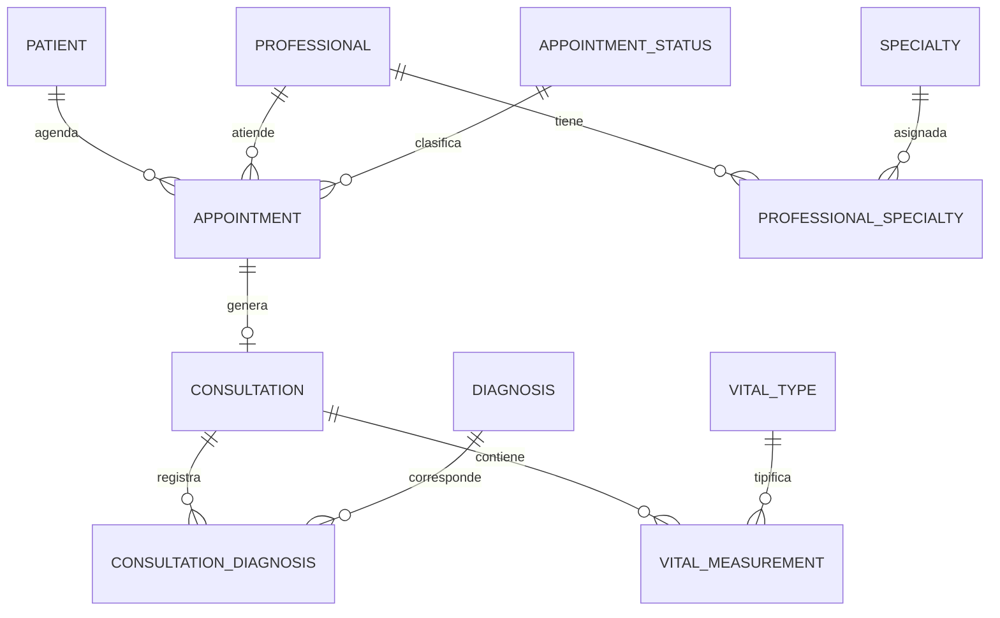

# Modelo relacional

## Propósito y alcance

El modelo representa el flujo básico de una clínica: registrar pacientes y profesionales, definir especialidades, agendar citas y documentar las consultas, sus diagnósticos y las mediciones clínicas. No incluye facturación, recetas, hospitalización, inventario ni autenticación.

## Diagrama de entidades

El diagrama muestra las entidades lógicas. Cada entidad se implementa en varias relaciones físicas debido a la descomposición en 6FN.

## Entidades lógicas y relaciones físicas

| Entidad lógica | Relaciones físicas en 6FN | Datos que representan |
|---|---|---|
| Paciente | `patient`, `patient_document_identifier`, `patient_given_names`, `patient_family_names`, `patient_birth_date`, `patient_sex_at_birth`, `patient_email`, `patient_phone` | Identidad, identificador documental y hechos personales/de contacto. |
| Profesional | `professional`, `professional_license`, `professional_given_names`, `professional_family_names`, `professional_email`, `professional_phone`, `professional_is_active` | Identidad, licencia y hechos del profesional. |
| Especialidad | `specialty`, `specialty_name` | Identidad y nombre único de la especialidad. |
| Profesional-especialidad | `professional_specialty` | Asociación muchos a muchos, sin atributos descriptivos duplicados. |
| Estado de cita | `appointment_status`, `appointment_status_name` | Código y nombre del estado. |
| Cita | `appointment`, `appointment_patient`, `appointment_professional`, `appointment_current_status`, `appointment_starts_at`, `appointment_duration_minutes`, `appointment_reason` | Identidad y cada hecho individual de la cita. La hora final se deriva del inicio más la duración. |
| Consulta | `consultation`, `consultation_appointment`, `consultation_consulted_at`, `consultation_clinical_notes` | Identidad, cita asociada, fecha y notas. |
| Diagnóstico | `diagnosis`, `diagnosis_name`, `diagnosis_description` | Código e información descriptiva. |
| Consulta-diagnóstico | `consultation_diagnosis` | Asociación muchos a muchos. |
| Tipo de medición | `vital_type`, `vital_type_name`, `vital_type_unit` | Código, nombre y unidad. |
| Medición | `vital_measurement`, `vital_measurement_value` | Identidad de la medición puntual y su valor numérico. |

## Cardinalidades y reglas

- Un paciente puede tener muchas citas; cada cita corresponde a un paciente.
- Un profesional puede atender muchas citas; cada cita tiene un profesional asignado.
- Un profesional puede tener varias especialidades y una especialidad puede corresponder a varios profesionales.
- Una cita puede no tener consulta o tener una sola. La restricción `UNIQUE` en `consultation.appointment_id` hace cumplir el máximo de una.
- Una consulta puede incluir varios diagnósticos y cada diagnóstico puede aparecer en varias consultas.
- Una consulta puede tener varias mediciones. La misma medición puede registrarse más de una vez si cambia la hora.
- La duración de una cita debe ser mayor que cero; su hora final se calcula sumando la duración a `starts_at`.

## Decisiones de diseño

- Los datos del paciente no se repiten en las citas ni consultas; se consultan mediante las relaciones de identidad.
- Los atributos descriptivos se guardan por separado de las claves y de las asociaciones.
- El identificador documental se trata como un valor atómico único (`document_identifier`) que incluye la representación definida por el proyecto para tipo y número.
- La unidad de medida se define en `vital_type_unit` y no se vuelve a almacenar en cada medición.
- Este esquema no impide por sí solo el solapamiento de citas de un profesional. La aplicación debe comprobar disponibilidad en una transacción, o se debe añadir una estrategia de bloqueo acorde a las reglas de la clínica.
- Los hechos separados pueden quedar incompletos si solo se inserta una parte de una entidad. La aplicación debe crear los identificadores y sus hechos obligatorios en una misma transacción.
- Los catálogos incluyen códigos iniciales para estados y tipos de medición. Los diagnósticos y especialidades deben cargarse según el catálogo aprobado por el proyecto.

## Archivo SQL

El esquema 6FN ejecutable está en [`../database/schema.sql`](../database/schema.sql). El ejemplo adicional de historial temporal está en [`../database/6fn_temporal_example.sql`](../database/6fn_temporal_example.sql).
