# Resumen de normalización del modelo compacto

## Alcance

El esquema físico de [`../database/schema.sql`](../database/schema.sql) lleva las relaciones del modelo hasta 6FN bajo las dependencias funcionales y reglas de negocio documentadas aquí. La 6FN implica las formas anteriores; no significa que exista una tabla separada por cada forma normal. El archivo temporal opcional [`../database/6fn_temporal_example.sql`](../database/6fn_temporal_example.sql) ilustra además cómo registrar cambios independientes a través del tiempo.

La normalización depende de las reglas reales del negocio. Si cambian las reglas de identidad, unicidad o asociación, se deben volver a verificar las claves y dependencias.

## Relación inicial sin normalizar

Una hoja de atención podría combinar en una fila la identidad del paciente, los datos del profesional, la cita y listas de especialidades, diagnósticos y mediciones. Esa estructura mezcla entidades y grupos repetidos, duplica descripciones y hace difícil actualizar la información sin anomalías.

La descomposición toma como referencia estas dependencias: cada identificador de paciente, profesional, cita o consulta determina su propia información; los códigos determinan los nombres de catálogos; y las asociaciones entre entidades se registran como hechos independientes.

## Primera forma normal (1FN)

**Regla:** cada atributo almacena un valor atómico para el dominio establecido y cada fila se identifica mediante una clave.

**Aplicación:** no se guardan listas de especialidades, diagnósticos ni mediciones en una celda. Las relaciones de asociación usan una fila por par relacionado. `document_identifier` se define como una sola representación atómica del identificador documental, según el formato elegido por el proyecto.

## Segunda forma normal (2FN)

**Regla:** estar en 1FN y que cada atributo no clave dependa de la clave completa, no de una parte de una clave compuesta.

**Aplicación:** las asociaciones con clave compuesta, como `professional_specialty(professional_id, specialty_id)` y `consultation_diagnosis(consultation_id, diagnosis_code)`, contienen solo las claves de la asociación. Los nombres, licencias y demás hechos se almacenan en relaciones cuya clave determina el atributo completo.

## Tercera forma normal (3FN)

**Regla:** estar en 2FN y no tener dependencias transitivas de atributos no clave respecto de una clave.

**Aplicación:** cada hecho descriptivo se separa de la entidad o asociación a la que pertenece. Por ejemplo, `appointment_current_status` guarda el código de estado, mientras que `appointment_status_name` contiene el nombre determinado por ese código. Los nombres de especialidades, diagnósticos y tipos de medición también se separan de sus códigos.

## Forma normal de Boyce-Codd (BCNF)

**Regla:** para cada dependencia funcional no trivial `X → Y`, `X` debe ser una superclave.

**Aplicación:** las relaciones de hechos usan claves primarias que determinan el único atributo no clave; las claves alternativas conocidas se refuerzan con restricciones `UNIQUE`. Por ejemplo, el identificador documental, la licencia profesional y los correos registrados son únicos según las reglas asumidas.

## Cuarta forma normal (4FN)

**Regla:** estar en BCNF y no combinar dependencias multivaluadas independientes en una misma relación.

**Aplicación:** las especialidades de un profesional se registran en `professional_specialty`, independientemente de otros posibles conjuntos multivaluados. Los diagnósticos de una consulta se almacenan en `consultation_diagnosis`. No se forma un producto entre especialidades, diagnósticos y mediciones.

## Quinta forma normal (5FN)

**Regla:** no debe existir una dependencia de reunión no trivial que permita dividir una relación y recomponerla con exactamente las asociaciones válidas.

**Aplicación:** las asociaciones muchos a muchos se representan en relaciones puente; no se descomponen en relaciones más pequeñas sin una regla de negocio que garantice que la reunión reconstruirá las asociaciones originales sin generar pares o ternas espurios. Se asume que cada fila de esas asociaciones representa una relación real.

## Sexta forma normal (6FN)

**Regla:** la relación no admite una descomposición no trivial sin pérdida. En diseños de hechos, esto se logra separando propiedades que pueden cambiar o existir independientemente.

**Aplicación en el esquema:** las tablas de identidad (`patient`, `professional`, `specialty`, `appointment_status`, `appointment`, `consultation`, `diagnosis`, `vital_type`) contienen solo claves. Las tablas de hechos como `patient_given_names`, `appointment_starts_at`, `consultation_clinical_notes`, `diagnosis_name` y `vital_type_unit` contienen su clave y un solo atributo no clave. Las tablas puente contienen únicamente las claves de la asociación.

Por ejemplo, una cita ancha con paciente, profesional, estado, hora, duración y motivo se descompone en `appointment` y en una relación separada para cada hecho: `appointment_patient`, `appointment_professional`, `appointment_current_status`, `appointment_starts_at`, `appointment_duration_minutes` y `appointment_reason`. Su reconstrucción requiere unir esas relaciones por `appointment_id`.

El ejemplo temporal opcional extiende esta idea: separa identidad, consulta, tipo, valor y nota, permitiendo que el valor y la nota tengan historiales de vigencia independientes. Usa intervalos con inicio y fin; el valor `9999-12-31 23:59:59` puede representar una vigencia abierta. En producción deben definirse reglas para evitar intervalos superpuestos y controlar cambios concurrentes.

## Resumen

| Forma normal | Cómo se aplica |
|---|---|
| 1FN | Valores atómicos y ausencia de listas repetidas en una columna. |
| 2FN | Cada atributo depende de la clave completa; las tablas puente no repiten atributos parciales. |
| 3FN | Los atributos descriptivos y catálogos se separan para evitar dependencias transitivas. |
| BCNF | Cada determinante funcional asumido es una superclave. |
| 4FN | Las asociaciones multivaluadas independientes se guardan por separado. |
| 5FN | Las asociaciones solo se descomponen si la regla de reunión conserva exactamente las filas válidas. |
| 6FN | Tablas de identidad con claves, hechos separados y asociaciones sin atributos descriptivos adicionales. |

## Consecuencias del diseño

- Se necesitan más uniones para reconstruir entidades lógicas.
- Las tablas de hechos opcionales se representan mediante ausencia de fila, no mediante `NULL`.
- La base de datos no puede garantizar con una restricción simple que todos los hechos requeridos de una entidad se hayan insertado; la aplicación debe insertarlos dentro de transacciones.
- La regla de no solapar citas requiere validación transaccional adicional.
- La 6FN aquí es una decisión académica de diseño; un sistema clínico real también requiere auditoría, permisos, protección de datos y revisión de las reglas locales.
## Proceso ampliado de normalización (0FN a 6FN)

**Proyecto:** Pulso Vital — Sistema de Salud y Monitoreo Clínico
**Motor objetivo:** MySQL 8.0+ (MySQL Workbench)
**Autores:** Alexander Arpushaina, Cristian Padilla

---

## 1. Introducción al Dominio

**Pulso Vital** modela la información clínica y operativa de una red de atención médica:
- **Pacientes** (identificación, datos demográficos, teléfonos, direcciones, aseguradoras, alergias).
- **Médicos** (licencia, especialidades, consultorios asignados).
- **Sedes y Consultorios** (ubicación física y especialidad habilitada).
- **Citas médicas** (programación, estado, diagnóstico CIE-10, prescripciones).
- **Signos vitales** (mediciones temporales de frecuencia cardíaca, presión sistólica, presión diastólica, temperatura corporal y saturación de oxígeno).
- **Cobertura de aseguradoras** (relación entre aseguradoras, especialidades y medicamentos autorizados).

A continuación se documenta la transformación progresiva desde una tabla universal sin normalizar (**0FN**) hasta la **Sexta Forma Normal (6FN)**.

---

## 2. Forma No Normalizada (0FN)

En el estado inicial, toda la información se almacena en una sola tabla plana `registro_clinico_bruto` (similar a una hoja de cálculo), con valores compuestos, listas separadas por comas y grupos repetidos.

### Esquema 0FN

`registro_clinico_bruto(id_cita, fecha_cita, paciente_documento, paciente_nombre, paciente_fecha_nac, paciente_telefonos, paciente_direccion, paciente_ciudad, paciente_departamento, aseguradora_nit, aseguradora_nombre, medico_licencia, medico_nombre, medico_especialidades, consultorio_codigo, consultorio_piso, sede_nombre, diagnostico_codigo, diagnostico_desc, medicamentos_recetados, signos_vitales, alergias)`

### Problemas observados en 0FN
1. **Atributos no atómicos:** `paciente_telefonos` (`"3001112233, 3104445566"`), `medico_especialidades` (`"Cardiología, Medicina Interna"`), `signos_vitales` (`"FC: 78; PA: 120/80; T: 36.6"`).
2. **Grupos repetidos:** `medicamentos_recetados` y `alergias` contienen múltiples elementos en una sola celda.
3. **Anomalías de inserción, actualización y borrado:** No es posible registrar un médico sin una cita, ni actualizar el nombre de una aseguradora sin recorrer todas las filas de sus pacientes.

> Implementación de referencia: [00_tabla_no_normalizada.sql](../sql/00_tabla_no_normalizada.sql)

---

## 3. Primera Forma Normal (1FN)

**Regla:** Cada atributo debe contener un único valor **atómico** (indivisible), no deben existir grupos repetidos y cada tabla debe tener una clave primaria definida.

### Transformaciones aplicadas
- Se dividen los atributos compuestos en columnas atómicas (`nombres`, `apellidos`, `frecuencia_cardiaca_lpm`, `presion_sistolica_mmhg`, `presion_diastolica_mmhg`, `temperatura_c`).
- Se eliminan las listas separadas por comas generando filas individuales para teléfonos, especialidades, alergias y medicamentos recetados.

### Relación resultante en 1FN (ejemplo consolidado)

- **`atencion_medica_1fn`** (`PK: id_cita, documento_paciente, telefono_paciente, alergia, licencia_medico, especialidad_medico, codigo_medicamento`)
  - Atributos restantes: `fecha_cita`, `nombres_paciente`, `apellidos_paciente`, `fecha_nac_paciente`, `direccion_paciente`, `ciudad_paciente`, `departamento_paciente`, `nit_aseguradora`, `nombre_aseguradora`, `nombre_medico`, `codigo_consultorio`, `piso_consultorio`, `nombre_sede`, `codigo_diagnostico`, `desc_diagnostico`, `nombre_medicamento`, `dosis`, `frecuencia_horas`, `fc_lpm`, `pa_sistolica`, `pa_diastolica`, `temperatura_c`.

Aunque ahora todos los valores son atómicos, la clave primaria compuesta genera **dependencias parciales** masivas.

---

## 4. Segunda Forma Normal (2FN)

**Regla:** Cumplir 1FN y asegurar que todo atributo no clave dependa funcionalmente de la **clave primaria completa**, eliminando dependencias parciales.

### Dependencias parciales detectadas en 1FN
- `documento_paciente -> nombres_paciente, apellidos_paciente, fecha_nac_paciente, direccion_paciente, ciudad_paciente, departamento_paciente, nit_aseguradora, nombre_aseguradora`
- `licencia_medico -> nombre_medico`
- `codigo_medicamento -> nombre_medicamento`
- `id_cita -> fecha_cita, documento_paciente, licencia_medico, codigo_consultorio, piso_consultorio, nombre_sede, codigo_diagnostico, desc_diagnostico`

### Descomposición a 2FN
- `pacientes_2fn(id_paciente PK, documento, nombres, apellidos, fecha_nac, direccion, ciudad, departamento, nit_aseguradora, nombre_aseguradora)`
- `medicos_2fn(id_medico PK, numero_licencia, nombre_completo)`
- `citas_2fn(id_cita PK, id_paciente FK, id_medico FK, fecha_hora, codigo_consultorio, piso_consultorio, nombre_sede, codigo_diagnostico, desc_diagnostico)`
- `medicamentos_2fn(id_medicamento PK, codigo_atc, nombre)`
- `prescripciones_2fn(id_cita PK/FK, id_medicamento PK/FK, dosis, frecuencia_horas)`
- `signos_vitales_2fn(id_medicion PK, id_paciente FK, registrado_en, fc_lpm, pa_sistolica, pa_diastolica, temperatura_c)`
- `paciente_telefonos_2fn(id_paciente PK/FK, telefono PK)`
- `paciente_alergias_2fn(id_paciente PK/FK, alergia PK)`
- `medico_especialidades_2fn(id_medico PK/FK, especialidad PK)`

---

## 5. Tercera Forma Normal (3FN)

**Regla:** Cumplir 2FN y eliminar **dependencias transitivas** entre atributos no clave (`A -> B -> C`, donde `A` es la PK y `B`, `C` son atributos no clave).

### Dependencias transitivas detectadas en 2FN
1. En `pacientes_2fn`:
   - `id_paciente -> nit_aseguradora -> nombre_aseguradora`
   - `id_paciente -> ciudad -> departamento`
2. En `citas_2fn`:
   - `id_cita -> codigo_consultorio -> (piso_consultorio, nombre_sede)`
   - `id_cita -> codigo_diagnostico -> desc_diagnostico`

### Descomposición a 3FN
- `departamentos(id_departamento PK, nombre)`
- `ciudades(id_ciudad PK, id_departamento FK, nombre)`
- `aseguradoras(id_aseguradora PK, nit, nombre)`
- `sedes(id_sede PK, codigo_sede, nombre, id_ciudad FK)`
- `consultorios(id_consultorio PK, id_sede FK, codigo_consultorio, piso)`
- `diagnosticos(id_diagnostico PK, codigo_cie10, descripcion)`
- `pacientes(id_paciente PK, documento, nombres, apellidos, fecha_nac, direccion, id_ciudad FK, id_aseguradora FK)`
- `citas(id_cita PK, id_paciente FK, id_medico FK, id_consultorio FK, id_diagnostico FK, fecha_hora, estado)`

---

## 6. Forma Normal de Boyce-Codd (FNBC / BCNF)

**Regla:** Para toda dependencia funcional no trivial `X -> Y`, `X` debe ser una **superclave** (es decir, todo determinante debe ser clave candidata).

### Caso real donde 3FN se cumple pero FNBC falla
Considérese la relación de asignación operativa:
`turnos_medico_especialidad(id_medico, id_especialidad, id_consultorio)`

Con las siguientes reglas de negocio:
1. Cada consultorio está equipado para una **única especialidad**: `id_consultorio -> id_especialidad`.
2. Un médico en una especialidad atiende en un consultorio asignado: `(id_medico, id_especialidad) -> id_consultorio`.
3. Las claves candidatas son `(id_medico, id_especialidad)` y `(id_medico, id_consultorio)`.

Todos los atributos forman parte de alguna clave candidata (es decir, son atributos primos), por lo que la tabla **cumple 3FN**. Sin embargo, viola **FNBC** porque `id_consultorio` determina a `id_especialidad`, pero `id_consultorio` **no es clave candidata**.

### Descomposición a FNBC
- `consultorios_especialidad(id_consultorio PK/FK, id_especialidad FK)`
- `asignacion_medico_consultorio(id_medico PK/FK, id_consultorio PK/FK)`

---

## 7. Cuarta Forma Normal (4FN)

**Regla:** Cumplir FNBC y eliminar **dependencias multivaluadas (DMV)** no triviales `X ->> Y` donde `X` no sea una superclave.

### Dependencias multivaluadas detectadas
Si se almacena en una sola tabla la información complementaria del paciente:
`paciente_contacto_alergia(id_paciente, telefono, id_alergia)`

Se producen dos DMV independientes:
- `id_paciente ->> telefono`
- `id_paciente ->> id_alergia`

Esto obliga a repetir cada teléfono por cada alergia del paciente (producto cartesiano innecesario).

### Descomposición a 4FN
- `paciente_telefonos(id_paciente PK/FK, telefono PK)`
- `paciente_alergias(id_paciente PK/FK, id_alergia PK/FK)`

---

## 8. Quinta Forma Normal (5FN / PJNF)

**Regla:** Cumplir 4FN y eliminar **dependencias de reunión (join dependencies)** no triviales que no estén implicadas por las claves candidatas.

### Caso de dependencia de reunión cíclica
Considérese la tabla de reglas de cobertura clínica:
`cobertura_clinica(id_aseguradora, id_especialidad, id_medicamento)`

Regla de negocio del dominio:
- Una aseguradora cubre ciertas especialidades.
- Una especialidad médica utiliza ciertos medicamentos.
- Una aseguradora autoriza ciertos medicamentos en su vademécum.
- Una combinación `(id_aseguradora, id_especialidad, id_medicamento)` es válida si y solo si existen las tres proyecciones binarias correspondientes:
  `*((id_aseguradora, id_especialidad), (id_especialidad, id_medicamento), (id_aseguradora, id_medicamento))`

### Descomposición sin pérdida a 5FN
- `aseguradora_especialidades(id_aseguradora PK/FK, id_especialidad PK/FK)`
- `especialidad_medicamentos(id_especialidad PK/FK, id_medicamento PK/FK)`
- `aseguradora_medicamentos(id_aseguradora PK/FK, id_medicamento PK/FK)`

La reunión natural de estas tres tablas reconstruye exactamente la relación original sin tuplas espurias ni redundancia.

---

## 9. Sexta Forma Normal (6FN)

**Regla:** Una relación está en **6FN** si y solo si **no admite ninguna dependencia de reunión no trivial** (relación irreducible). En términos prácticos para bases de datos temporales, cada tabla contiene únicamente:
- La **clave primaria** de la entidad (más su intervalo de validez temporal `[valido_desde, valido_hasta]`), y
- **A lo sumo un atributo** no clave que varía en el tiempo.

### Justificación en Pulso Vital
En el ámbito clínico, los atributos cambian de manera asíncrona e independiente:
- Un paciente cambia de dirección sin cambiar de aseguradora ni de teléfono.
- Su frecuencia cardíaca, presión arterial y temperatura se registran en instantes distintos.
- La dosis de un medicamento puede ajustarse sin alterar la frecuencia de toma.

Si todos los atributos mutables convivieran en una sola tabla histórica en 5FN, modificar un solo dato obligaría a duplicar todos los demás atributos vigentes en una nueva fila.

### Estructura Final en 6FN

#### Tablas Ancla (Identidad inmutable)
- `departamentos(id_departamento PK, codigo_dane UNIQUE)`
- `ciudades(id_ciudad PK, id_departamento FK, codigo_dane UNIQUE)`
- `aseguradoras(id_aseguradora PK, nit UNIQUE)`
- `sedes(id_sede PK, codigo_sede UNIQUE)`
- `consultorios(id_consultorio PK, id_sede FK, codigo_consultorio)`
- `especialidades(id_especialidad PK, codigo_especialidad UNIQUE)`
- `diagnosticos(id_diagnostico PK, codigo_cie10 UNIQUE)`
- `medicamentos(id_medicamento PK, codigo_atc UNIQUE)`
- `alergias(id_alergia PK, codigo_alergia UNIQUE)`
- `pacientes(id_paciente PK, tipo_documento, numero_documento, fecha_nacimiento, creado_en)`
- `medicos(id_medico PK, numero_licencia UNIQUE, creado_en)`
- `citas(id_cita PK, fecha_hora_programada, creado_en)`

#### Tablas Irreducibles 6FN (Un atributo temporal por tabla)
- **Paciente:**
  - `paciente_nombres_hist(id_paciente, valido_desde, valido_hasta, nombres)`
  - `paciente_apellidos_hist(id_paciente, valido_desde, valido_hasta, apellidos)`
  - `paciente_direccion_hist(id_paciente, valido_desde, valido_hasta, direccion)`
  - `paciente_ciudad_hist(id_paciente, valido_desde, valido_hasta, id_ciudad)`
  - `paciente_aseguradora_hist(id_paciente, valido_desde, valido_hasta, id_aseguradora)`
  - `paciente_telefono_hist(id_paciente, telefono, valido_desde, valido_hasta, tipo_telefono)`
  - `paciente_alergia_hist(id_paciente, id_alergia, valido_desde, valido_hasta, severidad)`
- **Signos Vitales (Series temporales irreducibles):**
  - `signo_frecuencia_cardiaca(id_paciente, registrado_en, valor_lpm)`
  - `signo_presion_sistolica(id_paciente, registrado_en, valor_mmhg)`
  - `signo_presion_diastolica(id_paciente, registrado_en, valor_mmhg)`
  - `signo_temperatura(id_paciente, registrado_en, valor_celsius)`
  - `signo_saturacion_o2(id_paciente, registrado_en, porcentaje_spo2)`
- **Médicos, Consultorios y Citas:**
  - `medico_nombre_hist(id_medico, valido_desde, valido_hasta, nombre_completo)`
  - `consultorio_especialidad(id_consultorio, id_especialidad)` *(FNBC)*
  - `medico_consultorio_hist(id_medico, id_consultorio, valido_desde, valido_hasta)` *(FNBC + Temporal)*
  - `cita_paciente(id_cita, id_paciente)`
  - `cita_medico(id_cita, id_medico)`
  - `cita_consultorio(id_cita, id_consultorio)`
  - `cita_estado_hist(id_cita, valido_desde, valido_hasta, estado)`
  - `cita_diagnostico(id_cita, id_diagnostico, registrado_en)`
  - `prescripcion_dosis_hist(id_cita, id_medicamento, valido_desde, valido_hasta, dosis)`
  - `prescripcion_frecuencia_hist(id_cita, id_medicamento, valido_desde, valido_hasta, frecuencia_horas)`
- **Cobertura (5FN):**
  - `aseguradora_especialidades(id_aseguradora, id_especialidad)`
  - `especialidad_medicamentos(id_especialidad, id_medicamento)`
  - `aseguradora_medicamentos(id_aseguradora, id_medicamento)`

---

## 10. Diagrama Entidad-Relación (Modelo 6FN Simplificado)

```mermaid
erDiagram
    PACIENTES ||--o{ PACIENTE_NOMBRES_HIST : "tiene"
    PACIENTES ||--o{ PACIENTE_DIRECCION_HIST : "registra"
    PACIENTES ||--o{ PACIENTE_ASEGURADORA_HIST : "afiliado"
    PACIENTES ||--o{ PACIENTE_TELEFONO_HIST : "contactos (4FN)"
    PACIENTES ||--o{ PACIENTE_ALERGIA_HIST : "alergias (4FN)"
    PACIENTES ||--o{ SIGNO_FRECUENCIA_CARDIACA : "mide"
    PACIENTES ||--o{ SIGNO_PRESION_SISTOLICA : "mide"
    PACIENTES ||--o{ SIGNO_TEMPERATURA : "mide"

    CITAS ||--|| CITA_PACIENTE : "asocia"
    PACIENTES ||--o{ CITA_PACIENTE : "asiste"
    CITAS ||--|| CITA_MEDICO : "atiende"
    MEDICOS ||--o{ CITA_MEDICO : "realiza"
    CITAS ||--|| CITA_CONSULTORIO : "usa"
    CONSULTORIOS ||--o{ CITA_CONSULTORIO : "aloja"
    CITAS ||--o{ CITA_ESTADO_HIST : "evoluciona"
    CITAS ||--o{ CITA_DIAGNOSTICO : "genera"

    CONSULTORIOS ||--|| CONSULTORIO_ESPECIALIDAD : "habilitado (FNBC)"
    MEDICOS ||--o{ MEDICO_CONSULTORIO_HIST : "asignado (FNBC)"

    ASEGURADORAS ||--o{ ASEGURADORA_ESPECIALIDADES : "cubre (5FN)"
    ESPECIALIDADES ||--o{ ESPECIALIDAD_MEDICAMENTOS : "usa (5FN)"
    ASEGURADORAS ||--o{ ASEGURADORA_MEDICAMENTOS : "aprueba (5FN)"
```

---

## 11. Archivos SQL Relacionados

- [00_tabla_no_normalizada.sql](../sql/00_tabla_no_normalizada.sql) — Tabla inicial 0FN con anomalías.
- [01_esquema_6fn.sql](../sql/01_esquema_6fn.sql) — Esquema completo en MySQL 8.0+ (6FN).
- [02_datos_prueba.sql](../sql/02_datos_prueba.sql) — Datos de prueba con historial temporal.
- [03_consultas_ejemplo.sql](../sql/03_consultas_ejemplo.sql) — Consultas temporales y reconstrucción de vistas clínicas.
